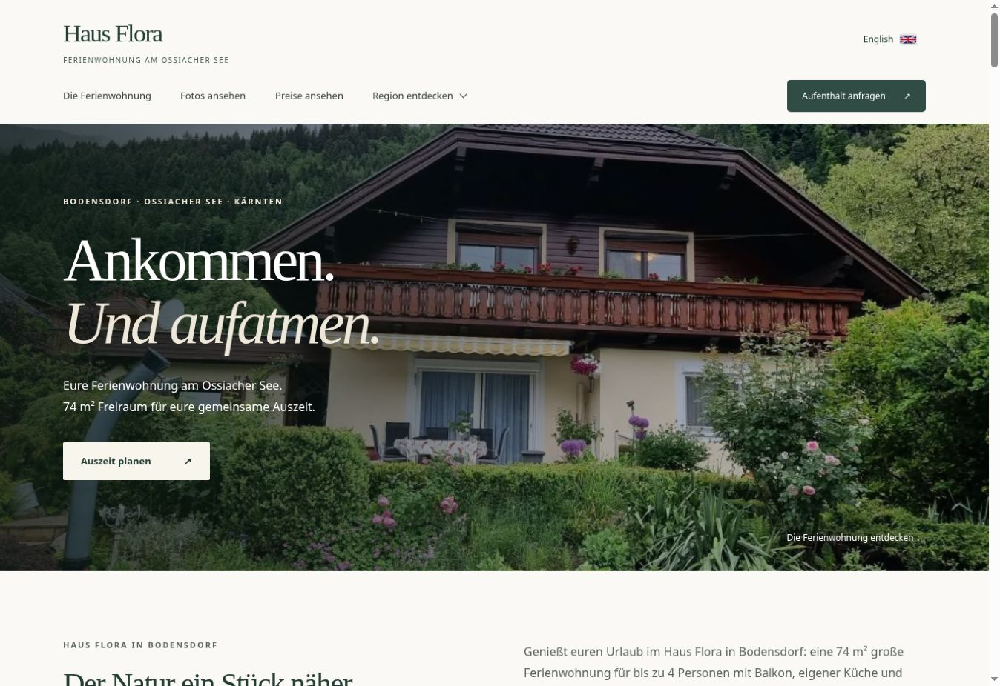
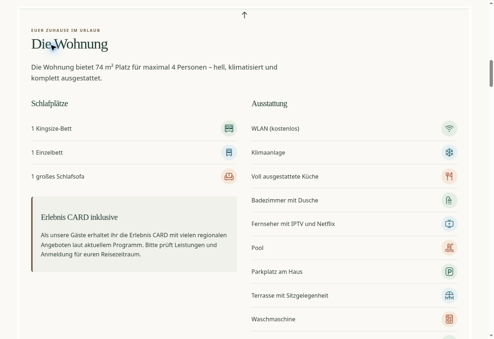
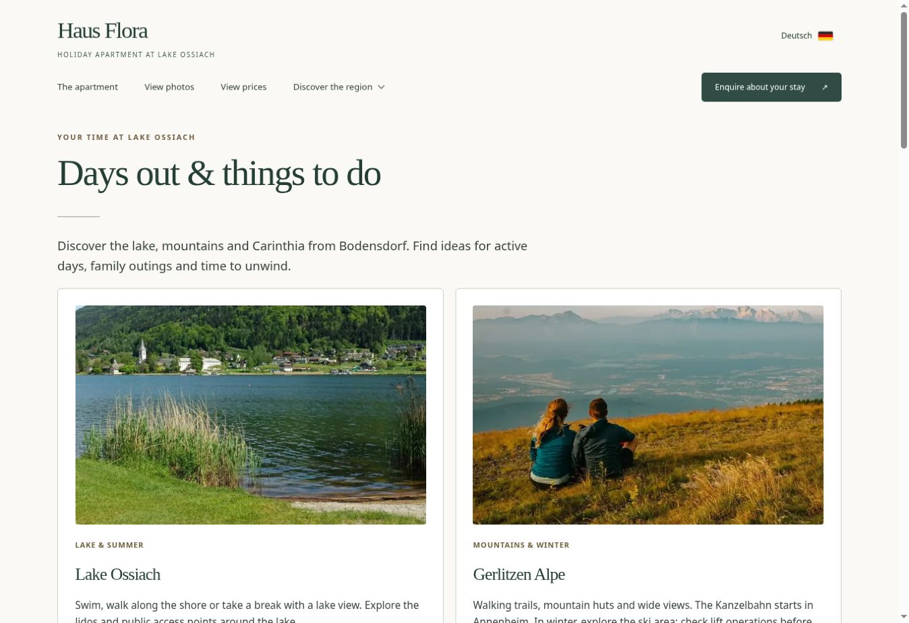

# Haus Flora – Ferienwohnungs-Website (Django)

Zweisprachige Website (Deutsch/Englisch) für die Ferienwohnung
**Haus Flora** in Bodensdorf am Ossiacher See – mit Belegungskalender,
Anfrageformular mit automatischer Preisberechnung und Adminbereich.

## Einblicke

### Startseite


### Ferienwohnung


### Discover the region (English)

Der Screenshot zeigt die Unterseite **„Days out & things to do“** unter `/en/umgebung/`.
**„Discover the region“** ist ein Menü mit mehreren Unterseiten: Ausflüge & Freizeit,
Umgebungsbilder, Radfahren und Urlaubslinks.



## Schnellstart (lokal)

```bash
# 1. In den Projektordner wechseln und virtuelle Umgebung anlegen
python -m venv .venv
.\.venv\Scripts\Activate.ps1  # Windows PowerShell
# .venv\Scripts\activate.bat  # Windows Eingabeaufforderung
# source .venv/bin/activate   # macOS/Linux

# 2. Abhängigkeiten installieren
pip install -r requirements.txt

# 3. Umgebungsdatei anlegen
#    .env.example zu .env kopieren und Werte eintragen (siehe unten)

# 4. Datenbank anlegen
python manage.py migrate
python manage.py loaddata property_photos
python manage.py prepare_photo_variants

# 5. Admin-Benutzer anlegen (für /admin/)
python manage.py createsuperuser

# 6. Server starten
python manage.py runserver
```

Danach:
- Website: http://127.0.0.1:8000/de/ bzw. http://127.0.0.1:8000/en/
- Admin:   http://127.0.0.1:8000/admin/

## Gmail-Versand einrichten

Damit Anfragen per E-Mail ankommen, braucht das Gmail-Konto ein
**App-Passwort** (das normale Passwort funktioniert nicht):

1. Im Google-Konto die 2-Faktor-Authentifizierung aktivieren.
2. Google-Konto → Sicherheit → „App-Passwörter" → neues Passwort
   erzeugen (Name z. B. „Haus Flora Website").
3. Das 16-stellige Passwort in der `.env` bei `EMAIL_HOST_PASSWORD`
   eintragen, die Gmail-Adresse bei `EMAIL_HOST_USER` und `OWNER_EMAIL`.

Solange **kein** Passwort gesetzt ist, werden Mails nur in der Konsole
ausgegeben – praktisch zum Testen.

## Booking.com-Kalender verbinden

1. Im Booking.com-Extranet **Kalender synchronisieren** öffnen.
2. **Kalenderverbindung hinzufügen** und **Zum Export springen** wählen.
3. Den privaten Booking.com-iCal-Link kopieren.
4. In der `.env` eintragen – ohne Anführungszeichen:

```env
BOOKING_ICAL_URL=https://admin.booking.com/hotel/hoteladmin/ical.html?t=...
BOOKING_ICAL_SYNC_MINUTES=30
```

5. Datenbank aktualisieren:

```bash
python manage.py migrate
```

6. Im Admin unter **Einstellungen** den Schalter
   **Booking.com-Kalender synchronisieren** aktivieren.
7. Server neu starten und die Kalenderseite öffnen. Die Website synchronisiert
   höchstens einmal pro eingestelltem Intervall. Manuelle Sperren bleiben dabei
   unverändert erhalten.

Für einen sofortigen manuellen Test:

```bash
python manage.py sync_booking_calendar
```

Der iCal-Link enthält einen privaten Zugriffscode. Er gehört nur in `.env` und
darf nicht in GitHub, Screenshots oder öffentliche Nachrichten gelangen.

## Adminbereich – was ihr dort machen könnt

| Bereich | Funktion |
|---|---|
| **Fotos** | Bilder hochladen, Reihenfolge ändern, ausblenden, löschen. Das erste sichtbare Foto ist automatisch das Startseiten-Bild. |
| **Belegte Zeiträume** | Manuelle Sperren und automatisch importierte Booking.com-Zeiträume ansehen. Die Nacht des Abreisetags ist frei. |
| **Anfragen** | Alle eingegangenen Anfragen ansehen (nur lesend). |
| **Einstellungen** | Preise, Regeln, Storno und Schalter ändern; Booking.com-Synchronisation aktivieren und ihren Status prüfen. |

## Spam-Schutz

Das Formular hat zwei unsichtbare Prüfungen (kein Captcha nötig):
ein Honeypot-Feld, das nur Bots ausfüllen, und eine Zeitprüfung
(Absenden unter 3 Sekunden nach Seitenaufruf wird abgelehnt).

## Preislogik

| Personen | Preis/Nacht |
|---|---|
| 1 Erwachsener | Preis für 2 Erwachsene −5 % |
| 2 Erwachsene | 150 € |
| 3 Erwachsene | 175 € |
| 2 Erwachsene + 1 Kind | 165 € |
| 2 Erwachsene + 2 Kinder | 180 € |
| alles andere (z. B. 4 Erwachsene) | nicht buchbar |

Die Preisübersicht rechnet Nächtigung, einmalige Endreinigung (80 €) und Nächtigungstaxe
zusammen. Die Nächtigungstaxe beträgt laut Betreiberangabe 4,50 € pro Person
ab 16 Jahren und Nacht und wird vor Ort bezahlt. Bei Kindern wird zusätzlich
abgefragt, wie viele bei der Anreise 16 oder 17 Jahre alt sind; unter 16 Jahren
fällt keine Nächtigungstaxe an. Die Unterkunftspreise bleiben gleich.
Migration 0004 aktualisiert auch bestehende Einstellungen auf 4,50 €.
Migration 0005 setzt die Endreinigung auch in bestehenden Einstellungen auf 80 €.
Alle Werte stammen aus dem Adminbereich. Die Logik steht in
`booking/pricing.py`.

## Qualität prüfen

```bash
python manage.py check
python manage.py test
```

Die Tests prüfen Preisberechnung, belegte Zeiträume, beide Sprachen und den
E-Mail-Versand inklusive korrekter Antwortadresse.

## Vor dem Livegang unbedingt

1. **Impressum und Datenschutz** vervollständigen: Betreibername, Betreiberanschrift und Kontakt im Admin eintragen. Die bestehenden Rechtstextvorlagen müssen weiterhin zu den tatsächlichen Leistungen und dem gewählten Hosting passen.
2. In der `.env`: `DEBUG=False`, echten `SECRET_KEY` setzen
   (`python -c "import secrets; print(secrets.token_urlsafe(50))"`)
   und die Domain bei `ALLOWED_HOSTS` eintragen.
3. `python manage.py collectstatic` ausführen.
4. HTTPS aktivieren (macht der Hoster, z. B. mit Let's Encrypt).

Als Hosting eignen sich z. B. PythonAnywhere (einfachster Einstieg),
Hetzner oder ein beliebiger Server mit Gunicorn + Nginx.

## Projektstruktur

```
haus-flora/
├── hausflora/          # Projekt-Konfiguration (Settings, URLs)
├── booking/            # Die eigentliche App
│   ├── models.py       # Fotos, Zeiträume, Anfragen, Einstellungen
│   ├── pricing.py      # Preisberechnung
│   ├── forms.py        # Anfrageformular + Spam-Schutz + Validierung
│   ├── views.py        # Seiten + Verfügbarkeits-API
│   ├── emails.py       # Mail an euch + Bestätigung an den Gast
│   ├── texts.py        # Alle Website-Texte (DE/EN)
│   └── admin.py        # Adminbereich
├── templates/          # HTML-Seiten
└── static/             # CSS + Kalender-JavaScript
```


## Bestehende Installation aktualisieren

Datenbank, `.env` und eigene Medien vorher sichern. Danach die neue Version übernehmen,
`python manage.py migrate` ausführen und im Produktivbetrieb die statischen Dateien mit
`python manage.py collectstatic --noinput` aktualisieren. Die Foto-Fixture nur bei einer
Neuinstallation laden: Sie verwendet feste IDs.

## Technik und Funktionen

Python 3.11+, Django 5.x, SQLite, HTML/CSS und JavaScript. Deutsch/Englisch,
Foto-Galerie mit Vollbildansicht, Preise, Belegungskalender, Anfrageformular,
E-Mail-Versand, Adminbereich und optionale Booking.com-iCal-Synchronisation.
Die Sprache wechselt ohne Sprung zu einem zuvor besuchten Abschnitt.
Der dezente Pfeil oben mittig führt zurück zum Hauptmenü.

GitHub enthält den Quellcode. Für den tatsächlichen Betrieb wird ein Python-/Django-Host benötigt;
GitHub Pages kann das Django-Backend nicht ausführen. E-Mail-Versand und Booking.com-Anbindung
werden über die lokale `.env` konfiguriert.
